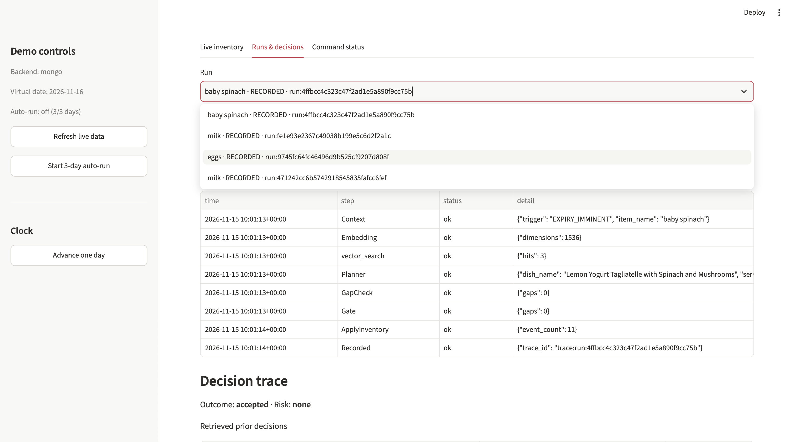
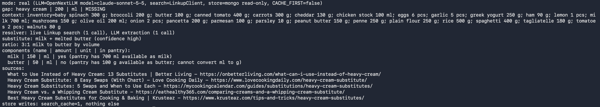

# Autonomous Pantry Agent

An agent that runs the pantry on its own. It notices what is about to expire or run out, plans a meal around it, checks the plan against real stock, finds sourced substitutes for anything missing, updates the inventory, and remembers what it decided. It acts alone when the plan is safe, and stops for a human when it is not.

Built for the Imperial AI Hackathon, Autonomous Agents track.



## The problem

Households throw away food because nobody tracks what is about to expire, and meal planning rarely starts from what is already in the pantry. Most recipe tools suggest dishes but never touch the inventory, so the next suggestion ignores what was just cooked.

## What it does

Every day the agent reacts to what is happening in the pantry:

1. **Detects** ingredients that are about to expire (`EXPIRY_IMMINENT`) or run low (`STOCK_DEPLETED`).
2. **Plans** one dish with an LLM planner that sees the currently available quantities (stock minus what is already reserved) and the number of servings.
3. **Checks gaps** by comparing the plan with real stock. Units are normalised (for example kg to g); when units cannot be converted safely (for example millilitres to grams) it does not guess.
4. **Finds substitutes** for missing items: the Resolver searches the web with Linkup, and an LLM extracts the substitute, the ratio and the components, keeping the cited sources.
5. **Passes a safety gate**: a run is auto-approved only if it has no unresolved gaps and no risk flag. Otherwise it stops in `GATED` and waits for a human to confirm or reject.
6. **Updates the inventory** with event-sourced reservations and deductions. Quantities never go negative, and a run can be undone.
7. **Remembers**: each decision is stored as a vector-searchable trace, so later days retrieve earlier decisions with MongoDB vector search.
8. **Stays auditable**: every step appears in a run timeline and a decision trace, every operator action goes through a command queue with visible status, and the steps are traced with MLflow.

The agent works day by day: each trigger produces one decision (one dish for two servings). The demo simulates three days.

## How it works

```
 Trigger rules --> Planner (LLM) --> Gap check --> Resolver (Linkup + LLM) --> Safety gate
 (expiry / low)         ^                                                        |
                        |                                   auto-approve --------+--- GATED: a human confirms or rejects
              Vector memory                                       |
         (MongoDB Atlas $vectorSearch)                  Reserve / deduct inventory --> Record trace
```

- **Store**: MongoDB Atlas holds the pantry, runs, inventory events, decision traces and caches. A local JSON store with fakes is used for offline development and tests.
- **Worker**: a long-running process that detects triggers, runs the pipeline, executes operator commands (`START_AUTO_RUN`, `ADVANCE_CLOCK`, `APPROVE`, `REJECT`, ...) and advances a simulated clock.
- **UI**: a Streamlit app with three tabs: Live inventory, Runs & decisions (timeline, decision trace, cited sources) and Command status. It reads live data from the same database and writes commands for the worker.
- **Caches**: plans and web searches can be cached (`CACHE_FIRST`) so the demo replays deterministically. `scripts/prewarm.py` fills the caches with real calls and verifies an offline replay.

## The demo run

With the caches prewarmed, three simulated days run automatically and every run ends `RECORDED` with no human click:

| Day | Trigger | Dish |
|---|---|---|
| 1 | milk about to expire | Creamy Broccoli and Ham Penne Bake-Style Pasta |
| 2 | milk about to expire | Spaghetti alla carbonara with milk and spinach |
| 2 | eggs about to expire | Creamy Spinach and Pancetta Spaghetti Carbonara |
| 3 | baby spinach about to expire | Lemon Yogurt Tagliatelle with Spinach and Mushrooms |

Later days retrieve earlier decisions from memory (see the `vector_search` row in each run's timeline).

The cached run has no missing ingredient, so it never calls Linkup. `scripts/linkup_demo.py` shows the Resolver live: a missing ingredient (for example 200 ml of heavy cream), a real Linkup search, LLM extraction of a substitute with cited sources, and a read-only check against the pantry. If the pantry cannot cover a component, or the units cannot be converted, the agent refuses to guess and a human must confirm.



## APIs, models and datasets

### APIs and services
- **OpenNext (OpenAI-compatible endpoint)**: chat completions (JSON mode, temperature 0) for the planner, the resolver extraction and other agents, and text embeddings for decision traces. Accessed through the `openai` Python SDK with a custom base URL.
- **Linkup**: web search that returns a sourced answer. The Resolver uses it to look up ingredient substitutions with citations. Results are cached in a `search_cache` collection.
- **MongoDB Atlas**: live store for the pantry, runs, inventory events, decision traces and caches. Atlas `$vectorSearch` (cosine similarity) retrieves similar past decisions, merged with a local numpy cosine search.
- **MLflow tracing (on Databricks)**: records the agent's steps as spans in the experiment `/Shared/pantry-agent`.

### Models
- **Chat model**: `claude-sonnet-5-5`, served through the OpenNext endpoint.
- **Embedding model**: `text-embedding-3-small` (1536 dimensions); the Atlas vector index uses the same dimension.
- **Offline fallback**: a deterministic fake LLM with hash-based embeddings, used only in tests and offline development.

### Datasets
All data is synthetic and was created during the hackathon (`seed_data/`). It is a demo fixture, not a real food-safety or nutrition dataset.
- Pantry: 29 starter ingredients with made-up quantities and expiry dates.
- Recipes: six recipe candidates with demo ingredient mappings, linking to published recipes (BBC Good Food) for reference only.
- Seed decision traces: four made-up past decisions used to bootstrap the memory.
- Household profiles, aliases, allergen map, staples and date labels: small fixtures used by the rules and safety checks.
- Reference links (no data copied): BBC Good Food, a Silver Spoon cream-substitution page, UK Food Standards Agency guidance on date labels and allergens.

### Main open-source libraries
pydantic, openai, linkup-sdk, pymongo, mlflow, streamlit, numpy, python-dotenv, pytest.

Provenance: this repository was created on 10 November and briefly held unrelated practice scripts, which are no longer part of it. All Pantry Agent code was written during the hackathon, starting from the project skeleton committed on 14 November.

## Run it

Requirements: Python 3.12, and for the live setup a MongoDB Atlas cluster, an OpenNext/OpenAI-compatible key and a Linkup key.

```bash
python -m venv .venv && source .venv/bin/activate
pip install -r requirements.txt
cp .env.example .env            # fill in your own credentials, never commit them
python scripts/preflight.py     # checks the services, must be all PASS
python scripts/seed.py          # seeds the pantry and the vector index
```

Run the three-day demo (three terminals, same machine, same `.env`):

```bash
# terminal 1: worker
python scripts/reset_demo.py
STORE_BACKEND=mongo python -m pantry.agents.worker

# terminal 2: operator
python scripts/send_command.py START_AUTO_RUN --wait 60
python scripts/send_command.py --list        # auto-run state and runs

# terminal 3: UI
streamlit run pantry/ui/app.py --server.headless true
```

Use `CACHE_FIRST=true` in `.env` to replay prewarmed plans, or run `python scripts/prewarm.py` once with `CACHE_FIRST=false` to fill the caches with real LLM and Linkup calls. See `docs/demo_runbook.md` for the full checklist and fallbacks.

Run the Resolver demo on its own (worker stopped, pantry just reset):

```bash
python scripts/reset_demo.py
python scripts/linkup_demo.py --item "heavy cream" --amount 200 --unit ml --no-cache
```

Run the tests (offline, fakes only):

```bash
python -m pytest -q
```

## Known limitations

- One decision per trigger; there is no multi-day meal planning yet.
- When units cannot be converted safely (for example millilitres to grams) the agent refuses to guess and asks a human.
- The household allergy profiles and allergen rules exist as fixtures, but guest allergies are not yet wired into the live planner.
- The demo uses prewarmed plans so it is deterministic; the same code path runs live with `CACHE_FIRST=false`.
- After a restart there is no resume of an unfinished run; reset and start again.

## Team

- **Yauhey Shum**: data store and infrastructure (MongoDB Atlas store, event-sourced inventory, vector memory), reliability fixes (unit normalisation, failure isolation, gap gate), prewarm and reset scripts, demo runbook.
- **Haojun Zou**: agents and pipeline (planner, Resolver with Linkup, orchestrator, worker and command queue, caching).
- **Xayah Tu**: seed data, Streamlit UI, README and demo materials.